# Virodh AI / Threat Guard — Function Call Graph & Execution Hierarchy

This document maps out **every key function call, caller-callee dependency, and data pipeline** in the Virodh AI (Threat Guard) codebase, extracted using **Understand-Anything** and Python AST static analysis across 116 core modules.

---

## 1. End-to-End Execution Sequence Diagram

```mermaid
sequenceDiagram
    autonumber
    actor Client as Client / API Caller
    participant Gateway as Virodh Gateway (virodh/gateway.py)
    participant Guard as Threat Guard Engine (guard/engine.py)
    participant Ingress as Ingress Sanitizer (guard/ingress.py)
    participant Extract as Extraction Pipeline (guard/extract/)
    participant Detect as Detectors Pool (guard/detectors/)
    participant Fusion as Risk Fusion (guard/fusion.py)
    participant Policy as Policy Arbitrator (guard/policy.py)
    participant Target as Upstream VLM (Gemini / Qwen / GPT-4o)
    participant Audit as Forensic Audit (guard/audit.py)

    Client->>Gateway: POST /v1/chat/completions (Image + Prompt)
    Gateway->>Guard: scan(visual_input)
    
    rect rgb(20, 25, 40)
        Note over Guard,Ingress: Phase 1: Ingress & Validation
        Guard->>Ingress: validate(image_bytes, prompt)
        Ingress-->>Guard: Sanitized RGBA tensor & SHA-256 hash
    end

    rect rgb(30, 20, 45)
        Note over Guard,Extract: Phase 2: Multi-Modal Feature Extraction
        Guard->>Extract: extract(image, prompt)
        par Parallel Visual Extraction
            Extract->>Extract: qr.decode_qr() (Full resolution)
            Extract->>Extract: ocr.read_text() (Standard & Inverted)
            Extract->>Extract: views.orient() (Un-mirror / Un-rotate)
            Extract->>Extract: text_quality.readability() (Ink contrast)
            Extract->>Extract: decoders.try_decode() (Base64 / Rot13 / Word-map)
        end
        Extract-->>Guard: AnalysisContext(segments, untrusted_tokens)
    end

    rect rgb(45, 35, 15)
        Note over Guard,Detect: Phase 3: Parallel Detection Engines
        Guard->>Detect: Dispatch via ThreadPoolExecutor
        par Multi-Vector Threat Analysis
            Detect->>Detect: InjectionDetector.analyse() (Instruction cue check)
            Detect->>Detect: HarmDetector.analyse() (Direct safety violation)
            Detect->>Detect: CompositeDetector.analyse() (Cross-modal split payload)
            Detect->>Detect: ObfuscationDetector.analyse() (Distortion penalty)
            Detect->>Detect: AdversarialEngine.scan_tensor() (Sub-pixel noise)
        end
        Detect-->>Guard: dict[detector_name, DetectorResult]
    end

    rect rgb(15, 40, 25)
        Note over Guard,Policy: Phase 4: Risk Arbitration & Decision Gate
        Guard->>Fusion: fuse(detector_results, config)
        Fusion-->>Guard: Final Calibrated Risk Score (0.0 - 1.0)
        Guard->>Policy: decide(risk_score, profile_thresholds)
        Policy-->>Guard: Decision (ALLOW | REVIEW | BLOCK)
        Guard->>Audit: log_scan(report, forensic_evidence)
    end

    alt Decision == ALLOW
        Guard-->>Gateway: Decision.ALLOW
        Gateway->>Target: Forward Request (Upstream VLM)
        Target-->>Gateway: Raw Completion
        Gateway->>Guard: output_guard.check_reply(completion)
        Gateway-->>Client: 200 OK (Sanitized Response)
    else Decision == REVIEW
        Guard-->>Gateway: Decision.REVIEW (Held for Quarantine)
        Gateway-->>Client: 403 Forbidden (Quarantine Envelope)
    else Decision == BLOCK
        Guard-->>Gateway: Decision.BLOCK (Drop Immediately)
        Gateway-->>Client: 400 Bad Request (Security Rejection Envelope)
    end
```



---

## 2. Core Subsystems & Call Graph Details

### 2.1 Threat Guard Engine (`guard/engine.py`)

The primary orchestration module for all security inspections.

| Caller Function | Callee Function | Target File | Purpose |
| :--- | :--- | :--- | :--- |
| `ThreatGuard.__init__()` | `load_guard_config()` | `guard/config.py` | Parses YAML configuration and risk thresholds |
| `ThreatGuard.__init__()` | `ThreadPoolExecutor()` | `concurrent.futures` | Initializes worker thread pool for parallel detectors |
| `ThreatGuard.scan()` | `validate()` | `guard/ingress.py` | Enforces byte limits, formats, and dimension constraints |
| `ThreatGuard.scan()` | `extract()` | `guard/extract/pipeline.py` | Extracts hidden, faint, rotated, and encoded visual text |
| `ThreatGuard.scan()` | `build_composite()` | `guard/detectors/composite.py` | Creates unified cross-modal token representations |
| `ThreatGuard.scan()` | `ThreadPoolExecutor.submit()` | `concurrent.futures` | Dispatches detectors asynchronously |
| `ThreatGuard.scan()` | `InjectionDetector.analyse()` | `guard/detectors/injection.py` | Checks prompt hierarchy and instruction overrides |
| `ThreatGuard.scan()` | `HarmDetector.analyse()` | `guard/detectors/harm.py` | Evaluates segments for dangerous topics |
| `ThreatGuard.scan()` | `CompositeDetector.analyse()` | `guard/detectors/composite.py` | Evaluates split-payload cross-modal attacks |
| `ThreatGuard.scan()` | `ObfuscationDetector.analyse()` | `guard/detectors/obfuscation.py` | Flags geometric and encoding distortion signals |
| `ThreatGuard.scan()` | `fuse()` | `guard/fusion.py` | Calculates weighted multi-detector risk score |
| `ThreatGuard.scan()` | `decide()` | `guard/policy.py` | Evaluates risk against policy thresholds |
| `ThreatGuard.scan()` | `log_scan()` | `guard/audit.py` | Persists JSON audit trace and telemetry |

---

### 2.2 Extraction Pipeline (`guard/extract/`)

Recovers hidden visual text that attackers attempt to conceal from human reviewers.

| Caller Function | Callee Function | Target File | Purpose |
| :--- | :--- | :--- | :--- |
| `extract()` | `decode_qr()` | `guard/extract/qr.py` | Scans full-resolution image for QR and barcodes |
| `extract()` | `read_text()` | `guard/extract/ocr.py` | Runs CPU OCR (RapidOCR) on standard and boosted views |
| `extract()` | `readability()` | `guard/extract/text_quality.py` | Measures per-line ink contrast against background |
| `extract()` | `views.orient()` | `guard/extract/views.py` | Generates inverted, mirrored, and rotated perspectives |
| `extract()` | `try_decode()` | `guard/extract/decoders.py` | Attempts Base64, Rot13, and word-mapping decoders |
| `_new_lines()` | `SequenceMatcher.ratio()` | `difflib` | Deduplicates overlapping text between view passes |

---

### 2.3 Detection Engines (`guard/detectors/`)

Specialized classifiers running concurrently across the extracted `AnalysisContext`.

| Caller Function | Callee Function | Target File | Purpose |
| :--- | :--- | :--- | :--- |
| `InjectionDetector.analyse()` | `_patterns()` | `guard/detectors/injection.py` | Regex evaluation of instruction-override cues |
| `InjectionDetector.analyse()` | `prompt_guard_score()` | `guard/llm.py` | Evaluates chunks via `meta-llama/llama-prompt-guard-2-86m` |
| `HarmDetector.analyse()` | `_policy_chain()` | `guard/llm.py` | Queries fallback chain of hosted policy classifiers |
| `CompositeDetector.analyse()` | `build_composite()` | `guard/detectors/composite.py` | Combines user prompt and visual text tokens |
| `ObfuscationDetector.analyse()` | `SCAFFOLD.search()` | `guard/detectors/obfuscation.py` | Identifies character substitution and spacer scaffolds |
| `_policy_chain()` | `_client()` | `guard/llm.py` | Retrieves authenticated OpenAI/Groq/Gemini HTTP client |

---

### 2.4 Virodh Gateway (`virodh/`)

OpenAI-compatible proxy serving production traffic.

| Caller Function | Callee Function | Target File | Purpose |
| :--- | :--- | :--- | :--- |
| `gateway.chat_completions()` | `authenticate_key()` | `virodh/security.py` | Validates Bearer API token and checks rate quotas |
| `gateway.chat_completions()` | `parse_inspection_units()` | `virodh/openai_compat.py` | Extracts prompt and image payloads from request JSON |
| `gateway.chat_completions()` | `inspector.inspect()` | `virodh/inspector.py` | Calls `ThreatGuard.scan()` under bounded concurrency |
| `gateway.chat_completions()` | `apply_policy()` | `virodh/policy.py` | Maps tenant policy to decision action |
| `gateway.chat_completions()` | `forward_upstream()` | `virodh/upstream.py` | Forwards allowed request to upstream VLM endpoint |
| `gateway.chat_completions()` | `store.record_transaction()` | `virodh/store.py` | Records token usage, latency, and decision audit |

---

### 2.5 Benchmark & Evaluation Suite (`pipeline/` & `eval/`)

Integrates with OmniSafeBench-MM to benchmark defenses against multimodal jailbreaks.

| Caller Function | Callee Function | Target File | Purpose |
| :--- | :--- | :--- | :--- |
| `run_pipeline.main()` | `load_config()` | `config/config_loader.py` | Merges experiment YAML configs and env variables |
| `PipelineRunner.run()` | `TestCaseGenerator.run()` | `pipeline/generate_test_cases.py` | Generates adversarial visual test cases |
| `PipelineRunner.run()` | `ResponseGenerator.run()` | `pipeline/generate_responses.py` | Executes defended completions across target VLMs |
| `ResponseGenerator.run()` | `ThreatGuardDefense.apply_defense()` | `tg_plugins/defenses/threat_guard.py` | Intercepts benchmark cases before model execution |
| `PipelineRunner.run()` | `ResultEvaluator.run()` | `pipeline/evaluate_results.py` | Dispatches safety judges and computes ASR metrics |
| `ResultEvaluator.run()` | `judge.evaluate_response()` | `evaluators/judge.py` | Evaluates model responses for harm severity and intent |

---

## 3. Interactive Knowledge Graph & Lessons

The full interactive knowledge graph generated by **Understand-Anything** can be explored directly:

1. **Launch Interactive Graph**:
   ```powershell
   powershell -ExecutionPolicy Bypass -File docs/understanding/open-dashboard.ps1
   ```
2. **Knowledge Graph Data**: Located in `docs/understanding/knowledge-graph.json` (594 nodes, 1413 edges).
3. **Structured Architectural Map**: Located in `docs/understanding/ARCHITECTURE.md`.
4. **Code Lessons**: Detailed line-range walkthroughs located in `docs/understanding/code-lessons.json`.
